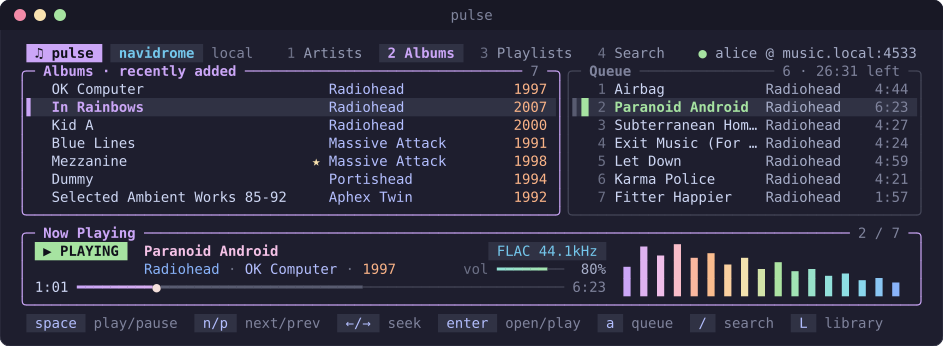

# pulse

A cross-platform terminal music player for [Navidrome](https://www.navidrome.org/) (and other
Subsonic-compatible servers) and for music folders on your own computer. Single binary, no
external player needed.

<p align="center">
  
</p>

## Features

- **Two libraries, one player:** your Navidrome server and a local music folder. Press `L` to
  switch between them; each keeps its own queue and place in the browser
- Browse artists, albums (recently added / played, most played, random, A–Z, starred), playlists
- Search across artists, albums and songs
- Play queue with play-next, reorder, remove, shuffle, repeat (off / all / one)
- **Gapless playback** — the next track is preloaded and spliced in sample-accurately
- Native decoding of MP3, FLAC, Ogg Vorbis and WAV
- Star songs, albums and artists, and keep play counts — on the server for Navidrome, in a local
  file for the music folder
- Scrobbles plays and "now playing" to Navidrome (and on to Last.fm/ListenBrainz if configured there)
- Password kept in the OS keyring (Windows Credential Manager, macOS Keychain, Secret Service)
- Styled with the full [Catppuccin Mocha](https://catppuccin.com/palette) palette: per-tab accent
  colours, gradient progress bar, and a live **spectrum visualizer** computed from the audio actually
  playing (press `v` to toggle). Your terminal's background (and its transparency) shows through by
  default; set `opaque_background = true` for solid Mocha backgrounds.

### Navidrome

Tracks start playing immediately while they download; seeking works mid-download for FLAC/WAV.
Formats pulse can't decode itself (AAC, ALAC, Opus, …) are transcoded to MP3 by the server.

### Local music folder

- Choose the folder from inside pulse with a built-in folder browser (`O`); drives, typed or pasted
  paths and `~` all work
- Files are grouped by their tags into artists and albums. Untagged files fall back to the file
  and folder names, and untagged compilations land under "Various Artists"
- `.m3u` / `.m3u8` files in the folder show up as playlists
- The scan is cached, so after the first one pulse starts instantly and only re-reads files that
  changed. It rescans in the background at startup; press `u` to rescan by hand
- AAC/M4A, ALAC, Opus, WMA, APE and other formats play through
  [ffmpeg](https://ffmpeg.org/) when it's installed (`winget install ffmpeg`, `brew install ffmpeg`,
  `apt install ffmpeg`). Without it they're skipped, and pulse tells you how many

## Install / build

Requires Go 1.27+. Everything is pure Go, so no C toolchain is needed on any platform:

```powershell
go build -trimpath -ldflags "-s -w" -o pulse.exe .   # Windows
```

```sh
go build -trimpath -ldflags "-s -w" -o pulse .       # macOS / Linux
```

On Linux, audio goes through PulseAudio or PipeWire (`pipewire-pulse`), which desktop
distributions run by default.

On Windows, use [Windows Terminal](https://aka.ms/terminal) (the default on Windows 11) for proper
Unicode and colour support; it works from both PowerShell and cmd.

## First run

```powershell
.\pulse.exe
```

The first launch asks for your Navidrome server URL, username and password, tests the connection,
saves the password in the OS keyring and writes the config file. Leave the URL empty to use only
local music: pulse then opens the folder browser so you can pick your music folder. Run
`pulse --setup` to connect a server later, and press `O` inside pulse to change the music folder.
See [`config.example.toml`](config.example.toml) for all options.

If the server can't be reached, pulse still starts — in local mode — and shows why.

Environment variables override the config file: `PULSETUI_SERVER`, `PULSETUI_USERNAME`,
`PULSETUI_PASSWORD`. If no keyring is available (e.g. a headless Linux box), set `PULSETUI_PASSWORD`.
(They aren't `PULSE_*` because that prefix belongs to PulseAudio — `PULSE_SERVER` is often already set.)

## Keys

| Playback | | Browse | |
|---|---|---|---|
| `space` | play / pause | `1`–`4` | artists / albums / playlists / search |
| `n` / `p` | next / previous | `/` | search |
| `←` / `→` | seek ∓10s | `enter` | open, or play from this song |
| `shift+←/→` | seek ∓60s | `esc` / `backspace` | back |
| `+` / `-` | volume | `a` | add to end of queue |
| `r` | repeat off / all / one | `A` | play next |
| `s` | shuffle upcoming tracks | `P` | play now (replace queue) |
| `R` | random mix | `f` | star / unstar |
| `v` | toggle visualizer | `o` | change album order |
| `tab` | switch browser ⇄ queue | `ctrl+r` | reload |
| `?` | all keys | | |

| Libraries | |
|---|---|
| `L` | switch between Navidrome and the local folder |
| `O` | choose the local music folder |
| `u` | rescan the local folder |

In the queue: `enter` plays, `d` removes, `K` / `J` move up / down, `X` clears.
Playback keys (`space`, `n`/`p`, seeking) control whatever is playing, even while you browse the
other library; the now-playing card shows which library it's from.
Mouse wheel scrolls; hold `shift` to select text in the terminal.

## How playback works

```
stream / file --> in-memory progressive buffer --> decoder goroutine --> ring buffer --> audio callback
                   (readers block until bytes arrive)  (decode + resample      (3 s, lock-light)   (WASAPI / CoreAudio /
                                                         to 44.1 kHz)                                PulseAudio via oto)
```

The audio callback never touches the network or disk, so a slow connection causes a brief silence
("buffering") rather than a stuck UI. When the current download completes (or 30 s before the
end), the next queued track starts buffering; when the current track drains, the callback switches
to it within the same audio buffer — no gap.

Each track carries its library's opener: Navidrome tracks stream over HTTP (transcoded by the
server when needed), local tracks are read straight from disk, and formats needing ffmpeg are
converted to raw PCM on the fly, which stays seekable.

MP3 and Ogg decoders scan the whole file when given a seekable input, so those formats start on a
forward-only reader and become seekable once the download has finished (instant for local files).
Tracks are held in memory while playing, so very large hi-res files use correspondingly more RAM.

## Development

```sh
go test ./...
go vet ./...
```

The player tests drive the audio callback directly with generated WAV/FLAC data, so they need no
sound device. The local library tests build real tagged files; those that need ffmpeg are skipped
when it isn't installed. The UI tests render every view at several terminal sizes and assert
nothing overflows.

```
main.go                 flags, first-run setup, wiring
internal/subsonic       Subsonic / OpenSubsonic API client (token auth)
internal/local          music folder library: scanner, cache, favourites, ffmpeg
internal/player         download -> decode -> ring buffer -> speaker engine
internal/ui             Bubble Tea model, views, key handling
internal/config         TOML config + OS keyring
```

The README screenshot (`docs/screenshot.svg`) is rendered from the real UI, so regenerate it after
visual changes:

```powershell
$env:PULSE_SCREENSHOT = 1; go test ./internal/ui -run TestScreenshot -count=1   # PowerShell
```

```sh
PULSE_SCREENSHOT=1 go test ./internal/ui -run TestScreenshot -count=1           # bash / zsh
```

## License

[MIT](LICENSE)
